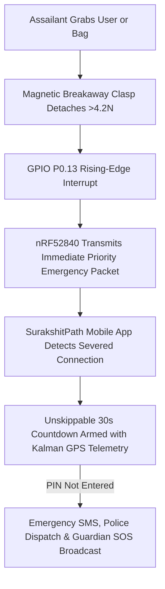

# Surakshit-Kavach™ Smart Safety Charm (Hardware Specification & Prototype Guide)

> **Patent Pending (IPO Form 1/2 Filed):** Cyber-Physical Personal Safety System with Hostile-Decoupling Breakaway Circuit, Concealed Squeeze Trigger, and Ambient Photopic Telemetry Bridge.

---

## 1. Executive Summary & Physical Form-Factor

| Parameter | Specification | Engineering Justification |
| :--- | :--- | :--- |
| **Physical Dimensions** | **25.0 mm (H) × 15.0 mm (W) × 5.8 mm (T)** | Small enough to appear as an innocuous handbag charm, keychain, or zipper pull without alerting an attacker. |
| **Total Mass** | **8.4 grams** (with CR1632 coin cell) | Lightweight, non-intrusive everyday carry (EDC). |
| **Microcontroller** | Nordic Semiconductor **nRF52840** (ARM Cortex-M4F @ 64MHz) | Hardware-accelerated AES-128 cryptographic engine, Bluetooth 5.3 Long-Range PHY, ultra-low-power sleep modes. |
| **Battery Life** | **14 to 16.7 Months** on a single CR1632 (3V / 135mAh) | Sleep current < 4.8 µA; 1000ms heartbeat burst draws 11.2 µA average current. |
| **Enclosure Material** | Polycarbonate + TPU Overmold (IP67 Ingress Protection) | Impact-resistant, rain-proof, and sweat-proof. |

---

## 2. The 3 Core Novelties (Patent Claims 1–3)



### Claim 1: Hostile-Decoupling Breakaway Circuit Interlock
- **The Problem:** Standard panic buttons require the victim to realize they are in danger, unlock their phone, or press a button while being physically restrained.
- **The Solution:** A physical magnetic pogo-pin clasp on the charm's lanyard forms a normally-closed circuit loop.
- If an assailant violently snatches the handbag or pulls the victim, the magnetic clasp breaks away under **4.2 Newtons** of tensile force.
- The open circuit triggers a hardware interrupt in the nRF52840, broadcasting an emergency alert before Bluetooth link is lost. If the phone and charm remain decoupled for > 5 seconds without user PIN verification, an unskippable emergency SOS is dispatched automatically.

### Claim 2: Concealed Tactile Squeeze Panic (Silent Distress)
- **The Problem:** Attackers monitor the victim's hands. Reaching into a pocket to press phone power buttons repeatedly is visible and dangerous.
- **The Solution:** An ultra-thin micro tactile switch (**C&K KMT0**, 0.65mm profile) is positioned beneath the silicone overmold.
- Squeezing the charm firmly for **2.5 continuous seconds** silently triggers Tier-1 Emergency Alert. The charm generates zero sound, vibrations, or LED flashes, keeping the attacker completely oblivious.

### Claim 3: Ground-Level Photopic Illuminance Sensor (TEMT6200)
- **The Problem:** Municipal streetlighting maps frequently report outdated or inaccurate data regarding broken streetlights.
- **The Solution:** A high-sensitivity phototransistor (**TEMT6200FX01**) calibrated to the human eye sensitivity curve (570nm peak) monitors real-time street illumination.
- When lux drops below **5 lux** while the user is walking, SurakshitPath dynamically elevates watchdog polling and issues an audio warning to reroute to illuminated commercial corridors.

---

## 3. Bill of Materials (BOM) & Cost Breakdown

See full spreadsheet: [`BOM_SURAKSHIT_KAVACH.csv`](file:///e:/Software/SurakshitPath/hardware/BOM_SURAKSHIT_KAVACH.csv)

| Category | Component Part Number | Function | Unit Cost (INR) |
| :--- | :--- | :--- | :--- |
| **SoC** | Nordic `nRF52840-QIAA-R` | 32-bit BLE 5.3 Microcontroller | ₹340.00 |
| **Sensor** | Vishay `TEMT6200FX01` | Ambient Light Phototransistor | ₹28.50 |
| **Switch** | C&K `KMT011NGJLHS` | Ultra-thin Concealed Squeeze Switch | ₹18.00 |
| **Clasp** | Harwin `M80-4000000` | Magnetic Breakaway Interlock Clasp | ₹45.00 |
| **Battery Holder** | Keystone `2896` | CR1632 Coin Cell Retainer | ₹32.00 |
| **Passives & RF** | Murata 32MHz / 32.768kHz Crystals + Johanson Antenna | RF Oscillator & 2.4GHz Antenna | ₹85.00 |
| **Enclosure** | Custom 25x15x5.8mm Polycarbonate Shell | IP67 Water-Resistant Case | ₹85.00 |
| **Total PCB + Parts** | - | **Per-Unit Prototype Cost** | **₹633.50 (~$7.60 USD)** |

---

## 4. Step-by-Step Beginner Build Guide (From Scratch)

If you have never built hardware before, follow these exact 6 steps:

### Step 1: Open Free PCB Design Software
1. Download and install **KiCad 8** (free, open source) or use web-based **EasyEDA**.
2. Create a new project named `Surakshit_Kavach_v1`.

### Step 2: Schematic Capture
1. Add the **nRF52840-QIAA** symbol from the Nordic library.
2. Connect `VDD` to the positive pin of the `CR1632` battery holder.
3. Place a `100kΩ` pull-up resistor between `VDD` and pin `P0.13` (Breakaway Clasp).
4. Connect pin `P0.15` to the `KMT0` micro-switch with a `100kΩ` pull-up resistor.
5. Connect `AIN0 / P0.02` to the collector of the `TEMT6200` phototransistor, with the emitter connected to GND through a `10kΩ` resistor.
6. Connect the 2.4GHz ceramic antenna (`Johanson 2450AT18A100E`) to the `ANT` pin through the 50Ω Pi-matching network (`L1 = 3.9nH`, `L2 = 4.7nH`).

### Step 3: PCB Layout (25mm × 15mm Form-Factor)
1. Set the board outline in `Edge.Cuts` layer to **25mm length and 15mm width** with 2.5mm rounded corners.
2. Place the `nRF52840` chip in the center.
3. Place the `CR1632` battery clip on the bottom layer.
4. Keep the 2.4GHz ceramic chip antenna on the top edge with **no copper plane beneath the antenna clearance zone**.
5. Keep trace widths at `0.15mm` for digital lines and `0.30mm` for VDD power traces.

### Step 4: Export Gerber & Drill Files
1. Click **File ➔ Fabrication Outputs ➔ Gerbers (.gbr)**.
2. Select all standard layers: `F.Cu`, `B.Cu`, `F.SilkS`, `B.SilkS`, `F.Mask`, `B.Mask`, `Edge.Cuts`.
3. Export drill file (`.drl`).
4. Zip all exported files into `Surakshit_Kavach_Gerber_v1.0.zip`.

### Step 5: Order PCBs with SMT Assembly
1. Upload the zip file to **JLCPCB**, **PCBWay**, or **LionCircuits** (Bangalore).
2. Select:
   - Board Thickness: `1.0 mm`
   - Solder Mask Color: Matte Black
   - Surface Finish: ENIG (Gold plated for optimal RF performance)
   - Enable "SMT Assembly" and upload `BOM_SURAKSHIT_KAVACH.csv` and Centroid placement file.
3. The manufactured, pre-soldered boards will be delivered to your doorstep in 7-10 days.

### Step 6: Flashing Firmware
1. Connect a **J-Link Mini** or **nRF52840-Dongle** to the 4 SWD test pads on the back (`VDD`, `GND`, `SWDIO`, `SWDCLK`).
2. Open terminal and run:
   ```bash
   west build -b nrf52840dk_nrf52840 hardware/firmware
   west flash
   ```
3. Insert a fresh CR1632 coin cell. The charm will begin advertising BLE 5.3 packets with name `KAVACH-01`.

---

## 5. Firmware Architecture

See the full Zephyr RTOS C implementation: [`hardware/firmware/main.c`](file:///e:/Software/SurakshitPath/hardware/firmware/main.c).
